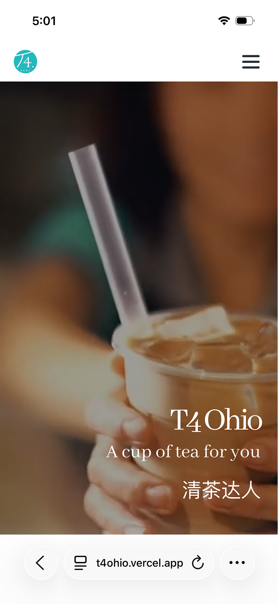
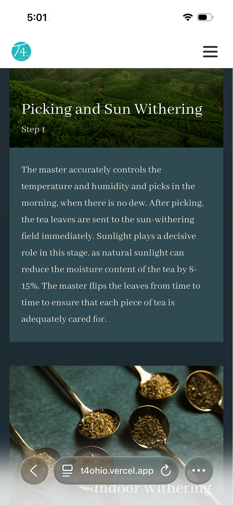

# T4 Ohio Website

T4 or Tea For U is a Taiwanese bubble tea shop franchise, this website was developed for the store in Centerville, Ohio.

## Features:
+ Responsive design
+ Supabase, Postgres backend
+ Deployed on Vercel
+ DevTools for user insights

## Page-by-page
### Landing
Users start on the landing page which contains promotional information and seasonal drinks, followed by a review section (rotating past reviews) and a button to prompt users to leave a review. Underneath is additional store infromation including hours and its location. At the bottom of each page is a footer with helpful links, and store contact information and social media pages.

### Philosophy
Next, the philosophy page steps through the tea-making process and showcases another promotional T4 video.

### Menu
At the top, customers can select from filters or search a specific drink. Menu items are sorted into collapsable categories, each drink or snack is displayed with its name, image, the price, and an add button. On clicking an item, a modal fills the screen, with options to customize the drink, select a sweetness level, toppings, and more. As requested by the client, clicking "Add to order" opens the item's link in the T4's Clover storefront. At the bottom of the ordering page, users can take a short quiz to receive a drink recommendation.

### Admin Panel
Admins can adjust availability, prices and more for menu items, as well as manage parts of the website, particularly replacing promotional and seasonal content. They cana lso view insights on page visits, most popular items, drink customization combinations, and even quiz results.

Visit at [t4ohio.vercel.app](https://t4ohio.vercel.app)